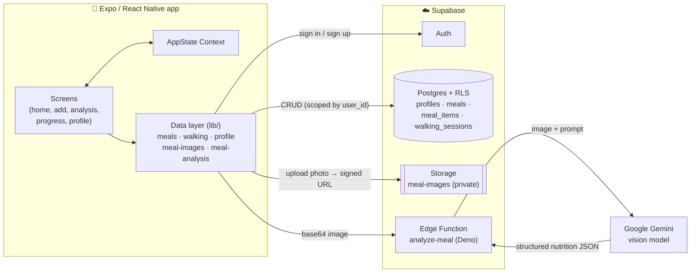

<div align="center">

# 🥗 GetFit Daily — AI Calorie Tracker

**Snap a photo of your meal, get a nutrition breakdown, and balance it against the calories you burn walking.**

A cross-platform mobile app built with **React Native (Expo)**, **TypeScript**, and **Supabase**.


</div>

---

## 📌 Overview

Most calorie trackers make you search a food database and type in portion sizes by hand. That takes enough effort that people stop logging. **GetFit Daily** cuts that down to one step: take a picture of your plate.

The photo is sent to a serverless **Supabase Edge Function**, which uses **Google Gemini** vision to return a list of food items, each with its weight, calories, protein, carbs, and fat. You review the result and save it. The app then compares what you ate today with the calories you burned on walks and shows your **net calorie balance** against a daily target.

I built this project end to end by myself: UI, data model, authentication, storage, and serverless backend.

---

## ✨ Features

| | Feature | Details |
|---|---|---|
| 📸 | **Photo-based meal logging** | Pick a photo from the camera or gallery. It is uploaded to private cloud storage and sent for analysis. |
| 🧠 | **AI food recognition** | An Edge Function sends the image to **Google Gemini** and returns structured nutrition data for each item. The client validates it before saving. |
| 📊 | **Daily nutrition dashboard** | Today's calories, protein, carbs, and fat, plus a list of every meal and the food items in it. |
| 🚶 | **Walking tracker** | Start / pause / resume / stop timer with a live calorie-burn estimate. Sessions are saved to the database. |
| ⚖️ | **Net calorie balance** | Consumed − burned, shown as a surplus or deficit against an 1,800 kcal daily target. |
| 📈 | **Progress views** | Today / This Week / Previous days tabs with bar charts. |
| 👤 | **Profile & BMI** | Save your weight and height. BMI is calculated live. |
| 🔐 | **Authentication** | Email/password sign-up and login with Supabase Auth, plus a deep-link callback (`getfit://auth/callback`) for email confirmation. |

---

## 🛠️ Tech Stack

| Layer | Technology |
|---|---|
| **Mobile framework** | React Native 0.86, Expo SDK 57 |
| **Navigation** | Expo Router (file-based routing) |
| **Language** | TypeScript (strict typing across UI, data layer, and API contracts) |
| **State management** | React Context (`AppStateProvider`) |
| **Backend** | Supabase: Postgres, Auth, Storage, Edge Functions (Deno) |
| **AI** | Google Gemini (multimodal, JSON response mode) |
| **Security** | Postgres Row Level Security, private storage bucket, short-lived signed URLs |
| **Tooling** | Bun, ESLint, Prettier, EAS Build |

---

## 🏗️ Architecture



### Meal-logging flow

1. **Pick a photo:** `expo-image-picker` returns a local URI.
2. **Upload:** `lib/meal-images.ts` stores the file at `meal-images/{userId}/{timestamp}.jpg` and returns a 1-hour signed URL.
3. **Analyze:** `lib/meal-analysis.ts` converts the image to base64 and calls the `analyze-meal` Edge Function.
4. **Validate & save:** `lib/meals.ts` normalizes every numeric field, computes totals, and writes one `meals` row plus its `meal_items` rows.
5. **Display:** the home screen reloads today's meals and recalculates the totals.

---

## 💡 Engineering Highlights

These are the parts of the code I found most interesting to work through:

- **Manual rollback across two tables.** Saving a meal writes a parent `meals` row and then its child `meal_items` rows. If inserting the items fails, the parent row is deleted, so the database never keeps a meal without items. ([`mobile/lib/meals.ts`](mobile/lib/meals.ts))
- **Reliable AI calls.** The Edge Function checks the caller's Supabase JWT before doing any work. It requests JSON-only output from Gemini, retries `429`/`503`/`404` responses with linear backoff, and falls back to a second model if the first stays unavailable. Stray markdown fences are stripped before parsing. ([`supabase/functions/analyze-meal/index.ts`](supabase/functions/analyze-meal/index.ts))
- **Defensive handling of AI output.** Model responses can't be trusted to be well-formed. Each value is coerced from string to number, checked with `Number.isFinite`, clamped to ≥ 0, and rounded before it reaches Postgres. A bad value produces a readable error naming the item and field. The response shape itself is also checked before use. ([`mobile/lib/meals.ts`](mobile/lib/meals.ts), [`mobile/lib/meal-analysis.ts`](mobile/lib/meal-analysis.ts))
- **Timezone-correct "today".** A naive `new Date()` comparison breaks near midnight when the device and the server are in different timezones. `getThailandTodayBounds()` uses `Intl.DateTimeFormat` to find the current date in `Asia/Bangkok` and converts it to exact UTC start/end bounds for database queries. ([`mobile/lib/date-range.ts`](mobile/lib/date-range.ts))
- **Security by default.** Every table has Row Level Security so users can only access their own rows. Photos go to a **private** bucket under a per-user folder and are read back through short-lived signed URLs. API keys live in a git-ignored `.env`.
- **Clear error messages.** Errors from the Edge Function are unwrapped from the HTTP response body, and database errors are prefixed with the table name and error code, so failures are easy to debug on a device.
- **Separation of concerns.** Routes (`app/`) are thin wrappers, presentational components live in `screens/`, and all Supabase access goes through typed functions in `lib/`. The UI never queries the database directly.

---

## 📂 Project Structure

```
get-fit-daily-main/
├── mobile/                      # 📱 React Native / Expo app
│   ├── app/                     # Expo Router routes (one file per screen)
│   │   ├── _layout.tsx          # Root layout + AppStateProvider
│   │   ├── login.tsx · register.tsx
│   │   ├── home.tsx · add.tsx · analysis.tsx
│   │   ├── progress.tsx · profile.tsx
│   │   └── auth/callback.tsx    # Email-confirmation deep link
│   ├── screens/                 # UI components for each screen
│   ├── lib/                     # Typed data-access layer
│   │   ├── supabase.ts          # Supabase client
│   │   ├── meals.ts             # Meal CRUD + validation + rollback
│   │   ├── meal-analysis.ts     # Calls the analyze-meal function
│   │   ├── meal-images.ts       # Uploads to private storage
│   │   ├── walking.ts           # Walking sessions
│   │   ├── profile.ts           # Weight / height
│   │   ├── app-state.tsx        # Global React context
│   │   └── date-range.ts        # Timezone-aware day bounds
│   ├── App.tsx                  # Screen orchestrator
│   └── styles.ts                # Shared design tokens
│
├── supabase/
│   ├── functions/analyze-meal/  # Deno Edge Function
│   └── migrations/              # Versioned SQL: tables, RLS, triggers, storage policies
│
└── (root)                       # Web scaffold: Vite + TanStack Start + shadcn/ui (planned)
```

---

## 🗄️ Data Model

```
auth.users ──1:1── profiles          (name, weight_kg, height_cm)
     │
     ├──1:N── meals                  (meal_type, name, image_path, calories, protein, carbs, fat, eaten_at)
     │          └──1:N── meal_items  (name, grams, calories, protein, carbs, fat)
     │
     └──1:N── walking_sessions       (duration_seconds, calories_burned, started_at, completed_at)
```

All foreign keys use `ON DELETE CASCADE`, so deleting a user removes their data, and deleting a meal removes its items. A trigger on `auth.users` creates the profile row automatically at sign-up. The full schema is in [`supabase/migrations/`](supabase/migrations/).

---

## 🚀 Getting Started

### Prerequisites

- [Bun](https://bun.sh) (or npm)
- A free [Supabase](https://supabase.com) project and the [Supabase CLI](https://supabase.com/docs/guides/cli)
- [Expo Go](https://expo.dev/go) on your phone, or an Android/iOS simulator

### 1. Clone and install

```bash
git clone https://github.com/pskpsk009/AiCalorieTracker.git
cd AiCalorieTracker/mobile
bun install
```

### 2. Configure environment variables

Create `mobile/.env`:

```env
EXPO_PUBLIC_SUPABASE_URL=https://your-project.supabase.co
EXPO_PUBLIC_SUPABASE_ANON_KEY=your-anon-key
```

Both values are in the Supabase dashboard under **Project Settings → API**.

### 3. Set up the database

```bash
supabase link --project-ref your-project-ref
supabase db push
```

This applies the versioned migrations in [`supabase/migrations/`](supabase/migrations/), which create the tables, RLS policies, the profile trigger, and the private `meal-images` bucket with its storage policies.

### 4. Deploy the Edge Function

Get a free API key from [Google AI Studio](https://aistudio.google.com/apikey), then:

```bash
supabase secrets set GEMINI_API_KEY=your-gemini-key
supabase functions deploy analyze-meal
```

### 5. Configure the auth redirect

In Supabase, go to **Authentication → URL Configuration** and add:

```
getfit://auth/callback
exp://127.0.0.1:8081/--/auth/callback   # for local testing with Expo Go
```

### 6. Run the app

```bash
bunx expo start
```

Scan the QR code with Expo Go, or press `a` (Android) / `i` (iOS) / `w` (web).

### Useful scripts

```bash
bunx expo start --android   # Android
bunx expo start --ios       # iOS
bunx expo lint              # Lint
bunx tsc --noEmit           # Type-check
bunx expo-doctor            # Diagnose dependency issues
```

---

## 🧭 Project Status & Roadmap

This is an active personal project. Here is what works today and what comes next:

**Working now**
- [x] Email/password auth with deep-link confirmation
- [x] Photo upload to private storage
- [x] End-to-end AI meal pipeline: image → Edge Function → Gemini → validation → Postgres
- [x] Daily nutrition totals, meal list, and meal deletion
- [x] Walking timer with saved sessions and net calorie balance
- [x] Profile with live BMI

**Next steps**
- [ ] Replace the sample data in the *This Week* and *Previous* views with real aggregated queries
- [ ] Personalized calorie target from BMR (Mifflin-St Jeor) using profile data, instead of the fixed 1,800 kcal
- [ ] Let users edit AI-detected items and portions before saving
- [ ] Step counting with `expo-sensors` for more accurate burn estimates
- [ ] Unit tests for `lib/` (validation, date bounds) with Jest
- [ ] Web companion app using the existing TanStack Start scaffold

---

## 📚 What I Learned

- Integrating a **multimodal LLM** into a product: prompting for structured JSON, handling rate limits and outages, and never trusting model output without validating it
- Designing a **typed contract** between a mobile client and a serverless function
- Working with **Postgres Row Level Security** and private storage, so access control lives in the database instead of only in the app
- Handling **timezones** correctly when "today" depends on the user's location
- Structuring a React Native app so routing, UI, and data access stay separate and are easier to change
- Setting up **deep linking** for the email-confirmation flow on mobile

---

## 👤 Author

**pskpsk009** · [GitHub](https://github.com/pskpsk009)

I'm looking for a **software engineering internship** where I can work on mobile, full-stack, or AI-powered products. Feedback on this project is welcome. Feel free to open an issue or reach out.

---

## 📄 License

MIT. See [LICENSE](mobile/LICENSE).
